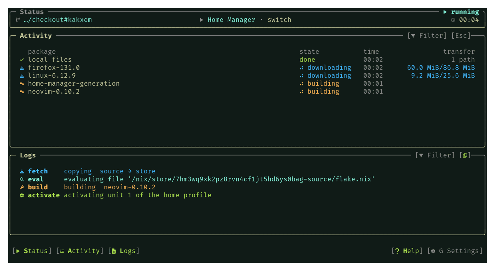

# nix-rebuild

An interactive rebuild interface for NixOS and Home Manager: a Rust terminal UI
that runs the rebuild, streams Nix's output as it happens, and records every run
so it can be read back later.



## Contents

In this file: [commands](#commands) · [install](#install) ·
[development](#development) · [license](#license)

The guides:

| guide | what it covers |
|---|---|
| [Install and options](docs/install.md) | the two modules, every `programs.nix-rebuild` option, the flags, how the checkout is chosen |
| [Using it](docs/usage.md) | the commands, the keys, the dialogs, copying the logs |
| [The frame](docs/frame.md) | the alternate screen, the Status, Activity and Logs cards, resizing |
| [Settings](docs/settings.md) | `config.toml` and the Settings dialog |
| [Recorded runs](docs/runs.md) | where runs live, their log, pruning and deletion |
| [Saved locks](docs/locks.md) | the lock an update replaces, and putting one back |
| [Development](docs/development.md) | the devShell, `nix flake check`, the package, the screenshot |

## Commands

```
nix-rebuild system          # build and switch NixOS
nix-rebuild system --boot   # register the generation for the next boot
nix-rebuild home            # build and switch Home Manager
nix-rebuild update          # refresh the lock file, build both, then activate both
nix-rebuild locks           # put a saved lock back and rebuild with it
nix-rebuild runs            # open a recorded run: list, read or delete them
nix-rebuild settings        # edit the remembered settings without rebuilding
```

`resume` still works as an alias for `runs`. `update` is a queue: `nix flake
update` inside the checkout, one `nix build`, then the activations. The keys are
in [Using it](docs/usage.md#keys).

## Install

It is consumed as a flake input. `nix-rebuild.homeManagerModules.default` goes in
the modules list of a `homeManagerConfiguration`, and
`nix-rebuild.nixosModules.default` installs the same wrapped binary in
`environment.systemPackages`, for a machine where every user needs it.

```nix
# flake.nix
inputs.nix-rebuild.url = "github:you/nix-rebuild";

# in the modules list of a homeManagerConfiguration:
programs.nix-rebuild = {
  enable = true;
  checkout = "/home/you/.config/nixos-dotfiles";
  system.config = "host";
  home = { config = "you"; manager = "standalone"; };
};
```

Every option and flag is in [Install and options](docs/install.md).

## Development

```
nix develop -c bash -c 'cd rust && cargo fmt --check && cargo test'
nix develop -c bash -c 'cd rust && cargo clippy --all-targets -- -D warnings'
nix flake check
```

The gates and the package layout are in [Development](docs/development.md).

## License

MIT, copyright 2026 kakxem.
